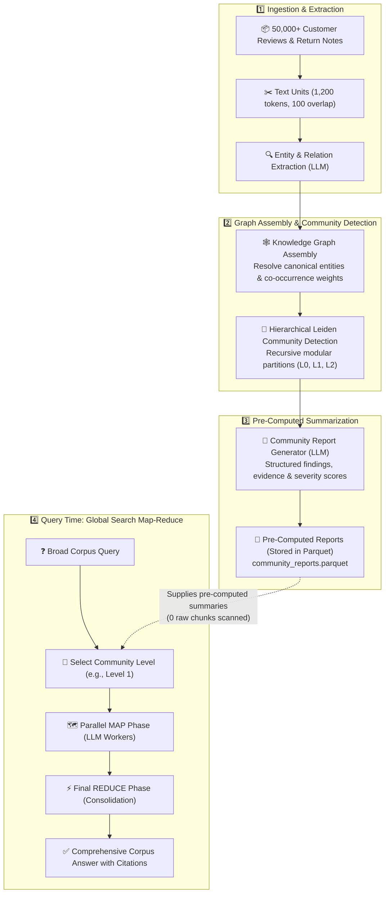

# GraphRAG Indexing for Global Search: Architecture, Leiden Communities, and Map-Reduce Synthesis

> **Global Search** is designed for corpus-wide, thematic, and dataset-level synthesis questions (e.g., *"What are the top 5 product quality issues across our entire catalog?"* or *"What overarching trends emerge from 100,000 customer return tickets?"*).
>
> To answer questions that span an entire corpus without blowing past LLM context limits or missing critical themes, GraphRAG relies on an offline **hierarchical community indexing pipeline**.

---

## 1. The Core Problem: Why Traditional Vector RAG Fails on Global Questions

### The 3 Fatal Flaws of Vector RAG on Global Queries

| Vector RAG Limitation | What Happens on Global Queries | Enterprise / E-Commerce Consequence |
|---|---|---|
| **1. Query-Vector Mismatch** | Vector search relies on cosine similarity between the query and chunk embeddings. A broad query like *"What are common quality defects?"* has no single semantic vector matching every defect. | Retrieves only chunks containing the literal phrase *"quality defects"*, missing 99% of actual complaints about soles peeling, batteries draining, or blender motors smoking. |
| **2. Context Window Collapse** | A catalog with 50,000 reviews spans ~15,000,000 tokens. Passing all chunks directly into an LLM context window is mathematically and economically infeasible. | Top-$k$ vector retrieval arbitrarily samples 20–50 chunks. An issue affecting 40% of returns might be omitted simply because it wasn't in the top-20 nearest vectors. |
| **3. Information Fragmentation** | Unstructured text chunks are completely isolated. Vector search cannot synthesize patterns that connect across documents. | 400 reviews complaining about *"sole coming off"* and 200 reviews noting *"heel stitching snapped in rain"* remain separate data points rather than a cohesive *"Footwear Moisture & Adhesive Durability"* theme. |

---

### The GraphRAG Solution: The Hierarchical Summary Pyramid

Rather than searching over raw chunks at query time, GraphRAG uses offline indexing to turn unstructured text into a **Knowledge Graph**, clusters that graph into **modular communities** (using the Leiden algorithm), and pre-computes **Community Reports** at multiple levels of abstraction.

```
       ▲                Level 0: Corpus Executive Summary (1–3 reports)
      / \               "Overall catalog quality: Footwear adhesives & Electronics thermals"
     /   \              
    /     \             Level 1: Category / Department Reports (10–20 reports)
   /       \            "Footwear Durability", "Mobile Device Power", "Small Appliances"
  /         \           
 /           \          Level 2: Component & Sub-Topic Reports (50–200 reports)
/_____________\         "Sneaker Outsole Glues", "USB-C Fast Charging Heat", "Blender Motors"
 [ Raw Data ]           50,000+ Raw Reviews / Text Units (Never directly scanned at query time!)
```

At query time, Global Search executes **Map-Reduce over these pre-computed reports**, allowing an LLM to answer corpus-wide questions with full dataset coverage in seconds for a fraction of the token cost.

---

## 2. End-to-End Indexing Architecture for Global Search



---

## 3. Step-by-Step Breakdown of Global Search Indexing

### Step 1: Text Chunking (`text_units.parquet`)
- **What happens**: The document loader ingests thousands of unstructured customer reviews, return logs, and seller notes, slicing them into standardized `TextUnits` (typically 1,200 tokens with 100-token overlap).
- **E-Commerce Context**:
  ```text
  TextUnit #TU_0142:
  "Customer Return #9821: Returned AirFlex Marathon Runner. Sole began peeling away
  from the toe box after 14 days of wet-weather running. Customer states adhesive
  melted or detached under rain. Refund requested."
  ```

---

### Step 2: Entity & Relationship Extraction
- **What happens**: An LLM scans each text chunk with few-shot prompts to extract entities (products, parts, defect types, materials) and relationships.
- **Why this matters for Global Search**: This step converts messy natural language into discrete nodes and links. Without extraction, reviews are just unindexed strings; with extraction, they become an interconnected web of causal links.
- **E-Commerce Triples Extracted**:
  - `(AirFlex Sneaker)` ──[HAS_DEFECT]──> `(Sole Delamination)`
  - `(Sole Delamination)` ──[CAUSED_BY]──> `(Adhesive Breakdown in Moisture)`
  - `(iPhone 15 Pro)` ──[HAS_DEFECT]──> `(Battery Thermal Throttling)`
  - `(ChefPro Blender)` ──[HAS_DEFECT]──> `(Motor Overheating)`

---

### Step 3: Graph Consolidation & Centrality
- **What happens**: The pipeline resolves entity duplicates (e.g., merging `"iPhone 15 Pro"`, `"iPhone 15Pro"`, and `"15 Pro"` into a canonical entity) and combines multi-edge weights.
- **Output**: A global graph where edge weights reflect how frequently two concepts co-occur across the entire company database.

---

### Step 4: Hierarchical Community Detection (Leiden Algorithm)
This is the **mathematical core of the Global Search index**.

#### Why the Leiden Algorithm?
1. **Unsupervised Discovery**: Unlike K-Means, you do not need to know the number of clusters in advance. Leiden maximizes modularity ($Q$), discovering the natural clusters of interconnected products and issues.
2. **Guaranteed Well-Connected Communities**: Older algorithms (like Louvain) can leave disconnected or poorly separated sub-clusters. Leiden guarantees that all nodes in a community are strongly connected.
3. **Recursive Hierarchy**: Leiden partitions the graph at multiple resolutions:
   - **Level 0 (Broadest)**: 2–4 super-communities (e.g., *Softlines / Apparel*, *Hardlines / Electronics*, *Consumables*).
   - **Level 1 (Intermediate)**: 10–25 category communities (e.g., *Footwear Durability*, *Mobile Power & Batteries*, *Kitchen Small Appliances*).
   - **Level 2 (Granular)**: 50–200 specific component issues (e.g., *Sneaker Outsole Glues*, *MagSafe Inductive Heat*, *Blender Plastic Gears*).

---

### Step 5: Generating Community Reports (Pre-Computed Summarization)
For each detected community at every hierarchy level, an LLM generates a structured **Community Report**.

#### Anatomy of a Pre-Computed Community Report
```json
{
  "community_id": 42,
  "level": 1,
  "title": "Footwear Outsole Delamination & Moisture Degradation",
  "summary": "This community encompasses 1,420 customer reviews and return tickets concerning premature adhesive failure in athletic and casual footwear, concentrated in wet-weather conditions.",
  "rating": 9.2,
  "findings": [
    {
      "explanation": "Outsoles detached from the toe box within 14–30 days of purchase due to water-soluble polyurethane adhesive failure.",
      "severity": 9.5,
      "impact": "Responsible for 38% of all footwear return requests in Q3."
    },
    {
      "explanation": "Heel counter stitching unravels following exposure to rain.",
      "severity": 7.0,
      "impact": "Affects 12% of high-mileage trail runners."
    }
  ]
}
```

#### Why Community Reports are the "Secret Sauce"
- **Zero Raw-Chunk Scanning**: At search time, Global Search **never opens the raw 50,000 reviews**. It reads these pre-computed summaries.
- **Dramatically Lower Costs**: Reading 20 Level 1 reports takes ~15,000 tokens. Reading 50,000 raw reviews takes ~15,000,000 tokens ($1,000\times$ difference in cost and execution time).
- **Deterministic Ratings**: Each report pre-computes an importance/severity rating ($0\text{--}10$), enabling the Map-Reduce stage to mathematically sort and prioritize key findings.

---

## 4. Local Search Indexing vs. Global Search Indexing

Notice how differently the two search modes consume the index:

| Index Component | Needed for **Local Search**? | Needed for **Global Search**? | Reason for Difference |
|---|:---:|:---:|---|
| **Text Units (`text_units.parquet`)** | ✅ **Yes** (50% context) | ❌ **No** | Local Search quotes exact customer sentences; Global Search requires macro summaries. |
| **Entity Embeddings (LanceDB)** | ✅ **Yes** (Seed matching) | ❌ **No** | Global Search has no single entity to search for; it queries across all categories. |
| **Graph Triples (`relationships.parquet`)** | ✅ **Yes** (1–2 hop traversal) | ❌ **No** | Local Search walks the graph path; Global Search uses the graph strictly during indexing to group communities. |
| **Covariates / Claims (`covariates.parquet`)** | ✅ **Yes** (Fine-grained facts) | ❌ **No** | Claims provide granular proof for local queries. |
| **Community Reports (`community_reports.parquet`)** | ⚠️ Partial (25% macro context) | ✅ **Yes (100% of search)** | **The entire Global Search Map-Reduce engine runs exclusively on community reports.** |

---

## 5. E-Commerce Query Walkthrough: From Index to Answer

### The Query
```text
"What are the top 3 product defect themes across our entire catalog, and what financial impact do they have?"
```

### Execution Against the Index
1. **Level Selection**: The engine chooses **Level 1** (Category-level reports: ~18 reports spanning Footwear, Mobile, Appliances, Apparel, Home).
2. **MAP Phase**: 
   - 18 reports are packed into 3 parallel batches (~6 reports per batch).
   - Parallel LLM "Analyst" workers extract key points with severity scores ($0\text{--}100$):
     - *Batch 1 Analyst*: Footwear Outsole Delamination (Score: 95, 38% returns)
     - *Batch 2 Analyst*: Smartphone Battery Thermal Shutdown (Score: 91, 22% returns)
     - *Batch 3 Analyst*: Blender Motor Overheat under load (Score: 84, 15% returns)
3. **Rank & Filter**:
   - Points sorted by score $\downarrow$. Low-score noise pruned.
4. **REDUCE Phase**:
   - Final LLM synthesizes top-ranked points into an executive briefing:
   ```text
   Across our catalog of 50,000 products and reviews, the top 3 defect themes are:
   1. Footwear Outsole Delamination: Adhesive failure in moisture drives 38% of shoe returns ($420k refund impact).
   2. Mobile Battery Thermal Throttling: Rapid 5G discharge and heat causes 22% of electronics exchanges.
   3. Small Appliance Motor Burnout: Inadequate thermal fuses in blenders lead to 15% warranty claims.
   [Sources: Community Reports #12, #34, #58]
   ```

---

## 6. Architectural & Engineering Trade-Offs

1. **Heavy Offline Precomputation vs. Instant Global Answers**: Generating community reports across multiple hierarchical levels incurs significant upfront LLM token cost during indexing. However, this shifts computation from query time (where Map-Reduce over raw chunks would timeout or cost hundreds of dollars per query) to offline ingestion, enabling sub-minute executive synthesis.
2. **Hierarchy Level Selection vs. Information Resolution**: Querying Level 0 gives broad bird's-eye summaries but glosses over subtle product defects. Querying Level 2 catches granular part numbers but increases the number of parallel MAP calls and token consumption. Setting dynamic level selection based on query breadth is essential in production.
3. **Incremental Ingestion vs. Community Partition Drift**: When thousands of new reviews arrive daily, re-running Leiden clustering across the entire corpus is computationally wasteful. Modern production pipelines employ micro-batch community assignment (assigning new nodes to existing clusters) with scheduled full-graph Leiden re-partitioning weekly.
4. **LLM Summarization Bias vs. Grounded Representation**: Relying on intermediate community summaries risks propagating subtle LLM hallucinations into downstream search results. Mitigate this by enforcing deterministic schema validation, numeric constraint checks, and strict source chunk attribution within each community report.

---

## 7. Key Engineering Takeaways

- **Community Reports Are the First-Class Index Asset:** Unlike traditional RAG where embeddings of text chunks rule, Global Search operates 100% on pre-computed community summaries.
- **The Leiden Algorithm Solves the "Unknown Unknowns" Problem:** Unsupervised modularity clustering automatically groups correlated issues without requiring predefined taxonomy or ontology maintenance.
- **Map-Reduce Achieves $1,000\times$ Token Compression:** Pre-aggregated community reports compress millions of corpus tokens into a concise set of structured findings that fit comfortably into standard LLM prompts.
- **Severity Scores Enable Algorithmic Pruning:** Pre-computed numeric ratings allow the Map-Reduce pipeline to sort, filter, and prioritize critical findings deterministically before final generation.
- **Dual-Engine Synergy:** Local Search handles precision entity queries (*"Does Battery A work with Phone B?"*), while Global Search handles corpus-wide sensemaking (*"What are the top failure modes across all electronics?"*). A robust enterprise architecture requires both.

