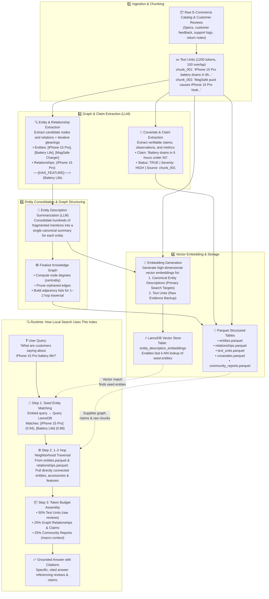
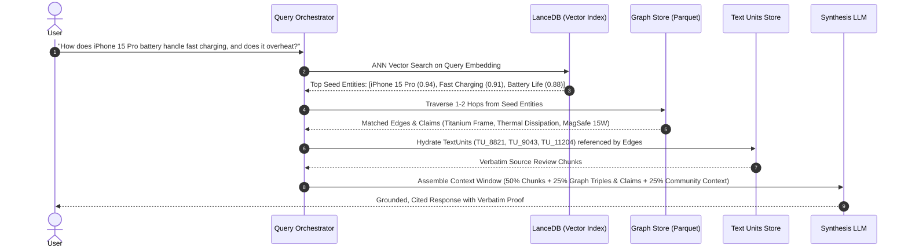

# GraphRAG Indexing for Local Search: Architecture, Mechanics, and Trade-Offs

> **Local Search** in GraphRAG is engineered specifically for entity-centric, relationship-driven, and "needle-in-a-haystack" discovery. Where traditional Vector RAG struggles with fragmented evidence across documents and Global Search focuses on corpus-wide macro summaries, Local Search bridges the gap by navigating fine-grained subgraphs grounded in verbatim source evidence.

---

## The Core Problem: Why Traditional RAG Falls Short

In standard semantic search and naive RAG, documents are cut into chunks and embedded into high-dimensional vector spaces. When a user asks:

> *"What are customers saying about the iPhone 15 Pro battery life under heavy 5G gaming, and does it overheat while using the fast charger?"*

Standard RAG searches for chunks whose aggregate text matches the query embeddings. This breaks down in production for three reasons:

1. **Semantic Dispersion**: The observations are scattered across thousands of disparate reviews, return forms, and specification sheets. No single chunk contains the complete answer.
2. **Entity Blindness**: Pure vector similarity conflates products sharing similar sentiment or vocabulary (e.g., standard iPhone 15 vs. iPhone 15 Pro) because it lacks explicit entity boundaries.
3. **Missing Relational Hops**: Vector distance cannot systematically traverse explicit connections (e.g., `[iPhone 15 Pro] ──(HAS_COMPONENT)──> [Titanium Frame] ──(CORRELATED_WITH)──> [Thermal Dissipation]`).

GraphRAG solves this by constructing a multi-layered index offline, combining:
- **Canonical Entity Descriptions** embedded in LanceDB for fast entry-point discovery.
- **Relational Knowledge Graph Edges & Covariate Claims** for 1–2 hop traversal.
- **Original Grounded Text Units** to ensure factuality and verifiable quotes.
- **Hierarchical Community Reports** to inject macro category context and eliminate tunnel vision.

---

## 1. End-to-End Indexing Architecture

The following diagram illustrates the complete offline indexing pipeline and how each artifact powers online local search runtime execution:



---

## 2. Step-by-Step Breakdown of Indexing Stages

### Stage 1: Document Ingestion and Chunking (`text_units`)
- **Mechanics**: Raw unformatted documents (product catalogs, user reviews, repair histories) are parsed into standardized chunks called `TextUnits`. The standard default configuration utilizes **1,200 tokens** per chunk with a **100-token sliding window** overlap.
- **Why Local Search Needs It**: Pure knowledge graphs can be overly abstract. To maintain enterprise-level faithfulness, Local Search quotes verbatim excerpts in its final synthesized answers. Every extracted node and edge retains explicit references to source `TextUnit` IDs.
- **Concrete Example**:
  ```text
  TextUnit #TU_8821:
  "Verified Buyer @tech_guru (Sept 28): I've been testing the iPhone 15 Pro for 2 weeks.
  Under heavy 5G streaming and gaming, the battery drains in 5.5 to 6 hours, and the titanium
  frame gets warm around the camera bump. The MagSafe 15W puck charger helps top it off
  quickly though."
  ```

---

### Stage 2: Dual-Pass Entity & Relationship Extraction
- **Mechanics**: Each `TextUnit` is processed through an LLM prompt that extracts domain entities (Name, Type, Description) and directed relationships (Source, Target, Description, Weight).
- **The Gleaning Pass**: Graph extraction is notoriously susceptible to false negatives. GraphRAG introduces an iterative "gleaning" round: the LLM is prompted a second time with: *"Did you miss any entities or relationships in the chunk above?"*. This captures long-tail attributes and subtle cross-entity relations.
- **Concrete Example**:
  - `Entity`: `iPhone 15 Pro` (Type: `PRODUCT`)
  - `Entity`: `Battery Life` (Type: `FEATURE`)
  - `Entity`: `Titanium Frame` (Type: `COMPONENT`)
  - `Entity`: `MagSafe 15W Charger` (Type: `ACCESSORY`)
  - `Relationship`: `(iPhone 15 Pro) ──[HAS_FEATURE]──> (Battery Life)`
  - `Relationship`: `(iPhone 15 Pro) ──[COMPATIBLE_WITH]──> (MagSafe 15W Charger)`

---

### Stage 3: Canonical Entity Consolidation & Summarization
- **The Challenge**: In a 50,000-document corpus, the entity `iPhone 15 Pro` may be extracted 3,400 times with fragmented, noisy, or conflicting descriptions.
- **Mechanics**: GraphRAG clusters all extraction instances by canonical entity name. An LLM summarization pipeline compresses these thousands of partial observations into a **single comprehensive entity profile**.
- **Concrete Example**:
  ```text
  Entity: iPhone 15 Pro
  Type: PRODUCT
  Consolidated Description:
  "Flagship smartphone released late 2023 featuring Apple's A17 Pro chip and titanium 
  enclosure. Customer sentiment is largely positive regarding camera performance and 
  weight reduction, but recurring reports highlight battery life constraints (averaging 
  5.5–7 hours under heavy 5G load) and localized thermal warming around the camera chassis 
  during rapid wireless charging."
  ```

---

### Stage 4: Covariates & Claims Extraction (The Secret Weapon)
- **Mechanics**: Beyond nodes and edges, the pipeline extracts verifiable dynamic observations—known as **claims** or **covariates**. Each claim is assigned a status, type, severity score, and source attribution.
- **Why Local Search Needs It**: When a user asks *"Is overheating a known defect or an isolated incident?"*, claims provide structured, quantitative evidence directly without forcing the LLM to infer consensus from raw text.
- **Concrete Example**:
  ```json
  {
    "subject": "iPhone 15 Pro",
    "object": "Battery Drain Under 5G",
    "type": "PERFORMANCE_CLAIM",
    "status": "TRUE",
    "severity": "MODERATE",
    "description": "Discharges in 5.5 to 6 hours under continuous 5G gaming and video streaming.",
    "source_text_unit": "TU_8821"
  }
  ```

---

### Stage 5: Finalizing the Knowledge Graph Topology
- **Mechanics**:
  1. Computes graph centrality metrics, notably **Node Degree Centrality** (number of connected edges), allowing Local Search to prioritize high-influence hubs.
  2. Prunes low-confidence orphaned edges.
  3. Prepares tabular outputs serialized as columnar Parquet files (`entities.parquet`, `relationships.parquet`).

---

### Stage 6: Vector Embedding of Entity Descriptions (LanceDB)
- **The Core Paradigm Shift**: Traditional RAG indexes raw text chunks in a vector database. In GraphRAG Local Search, **the vector index stores the canonical entity descriptions**.
- **Storage Layer**: Vectors are persisted in **LanceDB** under the `entity_description_embeddings` table.
- **Why This Matters**:
  When a user query arrives, an Approximate Nearest Neighbor (ANN) search matches against consolidated entity descriptions rather than arbitrary paragraph chunks. It immediately pinpoints the exact starting nodes (`iPhone 15 Pro`, `Battery Life`, `Fast Charging`) to enter the graph.

---

### Stage 7: Community Hierarchy & Macro Context
- **Mechanics**: The Leiden hierarchical community detection algorithm clusters the graph into multi-level topical modules.
- **Role in Local Search**: While Community Reports are primarily built for Global Search Map-Reduce tasks, Local Search reserves **25% of its prompt token budget** for the community reports surrounding the seed entities. This prevents hyper-local "tunnel vision" and equips the LLM with broader industry or category perspective.

---

## 3. Index Artifacts: Local vs. Global Search

| Index Artifact | Format | Used by Local Search? | Used by Global Search? | Role in Local Search |
|---|:---:|:---:|:---:|---|
| **`text_units.parquet`** | Parquet | **Yes (50% Token Budget)** | ❌ No | Supplies verbatim customer quotes and factual citations |
| **`entities.parquet`** | Parquet | **Yes (Focal Points)** | ❌ No | Provides canonical node profiles and attributes |
| **`entity_description_embeddings`** | LanceDB | **Yes (Seed Discovery)** | ❌ No | Vector ANN lookup to identify entry-point seed nodes |
| **`relationships.parquet`** | Parquet | **Yes (1–2 Hops)** | ❌ No | Traversable graph edges connecting components & features |
| **`covariates.parquet`** | Parquet | **Yes (Evidence Base)** | ❌ No | Structured claims (defect reports, benchmark findings) |
| **`community_reports.parquet`** | Parquet | **Yes (25% Token Budget)** | **Yes (100% Budget)** | Injects macro category context around local entities |

---

## 4. Query-Time Execution: How Local Search Consumes the Index

Consider an incoming user query:

> *"How does the iPhone 15 Pro battery handle fast charging, and does it overheat?"*



1. **Seed Entity Vector Matching**: LanceDB matches the query against entity descriptions, surfacing `iPhone 15 Pro`, `Fast Charging`, and `Battery Life`.
2. **Sub-Graph Traversal**: The engine follows adjacency lists 1–2 hops away, discovering `MagSafe 15W Charger` and `Titanium Frame`, alongside defect claims reporting surface temperatures up to 41°C.
3. **Chunk Hydration**: The system fetches exact `TextUnits` (`TU_8821`, `TU_9043`) linked to the active edges.
4. **Context Budget Allocation**:
   - **50% Raw Text Units**: Verbatim excerpts to anchor grounded citations.
   - **25% Knowledge Graph & Claims**: Triples and structured severity assertions.
   - **25% Community Summary**: High-level smartphone thermal dynamics overview.
5. **Grounded Generation**: The LLM synthesizes an authoritative answer with verifiable source citations.

---

## 5. Architectural & Engineering Trade-Offs

Deploying GraphRAG Local Search in enterprise production introduces meaningful architectural trade-offs:

### 1. Offline Precomputation Cost vs. Online Retrieval Speed
- **Trade-off**: Building the index requires substantial LLM API overhead—chunking, entity extraction, iterative gleanings, entity description consolidation, and community detection.
- **Analysis**: For static or slowly evolving corpora (product catalogs, legal case files, medical research), this upfront cost pays massive dividends at query time through fast LanceDB ANN lookup and direct Parquet graph traversal without runtime Map-Reduce overhead.

### 2. Index Freshness vs. Graph Recomputation
- **Trade-off**: Vector-only RAG easily supports streaming append-only insertions. Knowledge graphs, however, require updating node degree centralities, re-summarizing canonical entity descriptions, and recalculating community partitions when new documents arrive.
- **Mitigation**: Implement micro-batch indexing architectures where new chunks append local entities into an incremental delta index, while running full graph reconciliation on a periodic cadence.

### 3. Extraction Recall vs. Graph Noise
- **Trade-off**: Aggressive LLM extraction prompts with multiple gleaning passes catch nuanced long-tail relationships but risk hallucinating spurious entities or trivial connections. Conservative extraction yields clean graphs but leaves critical relational gaps.
- **Mitigation**: Employ strict node degree pruning, domain-specific entity ontology whitelists, and relationship confidence thresholding before storing to Parquet.

### 4. Context Budget Tension: Text Units vs. Graph Structure
- **Trade-off**: The LLM's context window is finite. Allocating too much space to raw text chunks turns GraphRAG back into naive RAG; allocating too much space to graph triples produces dry, abstract answers devoid of nuanced nuance and customer voice.
- **Empirical Sweet Spot**: The **50% Text Units / 25% Graph & Claims / 25% Community Reports** distribution provides optimal groundedness while maintaining relational intelligence.

---

## 6. Key Engineering Takeaways

1. **Entity Descriptions Are the Real Vector Target**: In Local Search, embedding raw text chunks is secondary. The primary vector search target is the **consolidated entity description in LanceDB**, which serves as the entry gate to the graph.
2. **Graph Structure Guides, Chunks Ground**: The knowledge graph determines *what* connected evidence is relevant; the raw `TextUnits` supply the *verbatim proof* required for hallucination-free enterprise QA.
3. **Covariates/Claims Bridge the Qualitative-Quantitative Divide**: Structured claims transform subjective prose into quantifiable assertions with explicit status, severity, and provenance.
4. **Local Search Complements, Rather Than Replaces, Global Search**: Use Global Search for high-level thematic queries (*"What are the major pain points across all 2026 products?"*) and Local Search for precision entity queries (*"Does Accessory X fit Product Y?"*).
5. **Storage Decoupling Matters**: Storing vector indexes in LanceDB and relational graph tables in columnar Parquet provides optimal performance, low cloud storage cost, and seamless integration with analytical engines.

